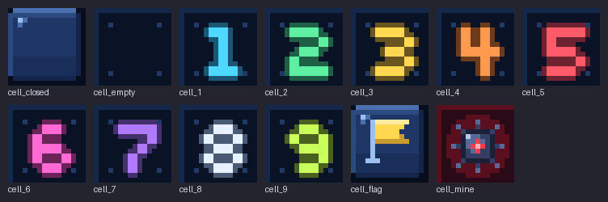
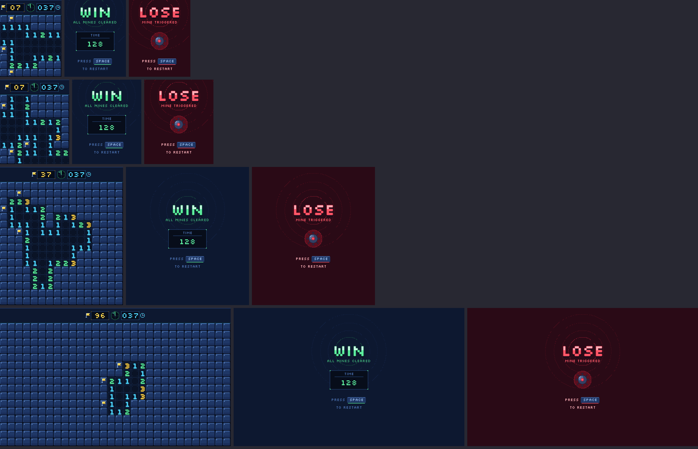
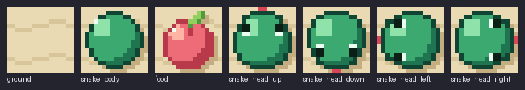
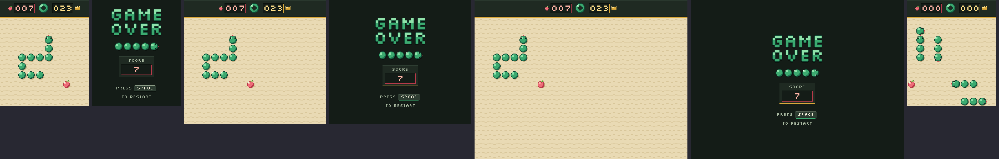
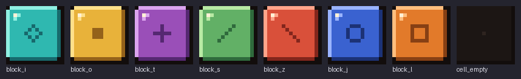
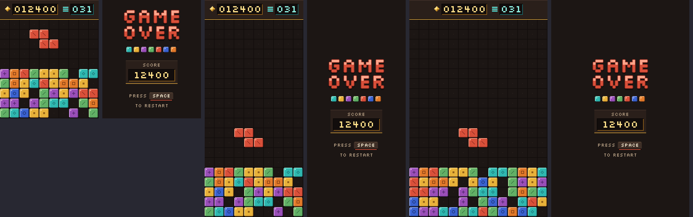

# pygame Mini-Game Assets

[한국어](README.md) | **English**

Pixel art assets for making mini-games with pygame.
Every cell is **16 × 16** pixels, with a **32**-pixel-tall header on top.

## How to get them

1. Click **Code → Download ZIP** at the top of this page and unzip it.
2. Copy the `<game>_assets` folder of your game **into the same place** as your `main.py`.
3. The `README.en.md` inside that folder explains each file and has example code.

| Game | Asset folder |
|---|---|
| Minesweeper | [minesweeper_assets](minesweeper/dist/minesweeper_assets/README.en.md) |
| Snake | [snake_assets](snake/dist/snake_assets/README.en.md) |
| Tetris | [tetris_assets](tetris/dist/tetris_assets/README.en.md) |

---

## Minesweeper

Asset list

In-game screens (by map size, win and lose screens)

## Snake

Asset list

In-game screens (by map size, game over screen)

## Tetris

Asset list

In-game screens (by board size, game over screen)

---

Font: [Silkscreen](https://fonts.google.com/specimen/Silkscreen) (SIL Open Font License, included in each `fonts/` folder)
