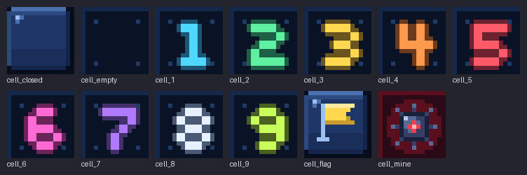
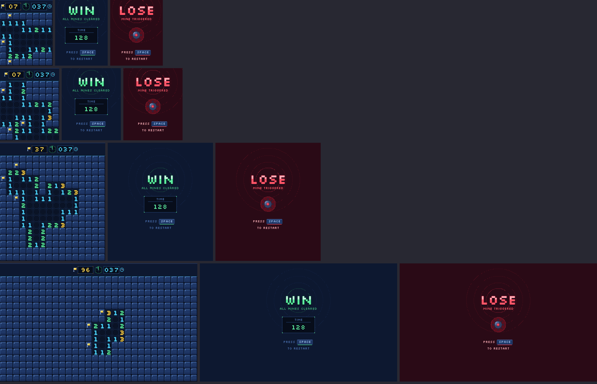
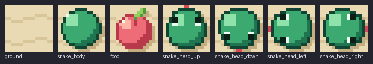
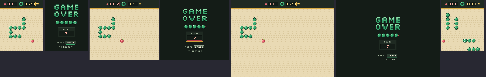
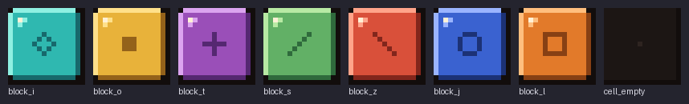
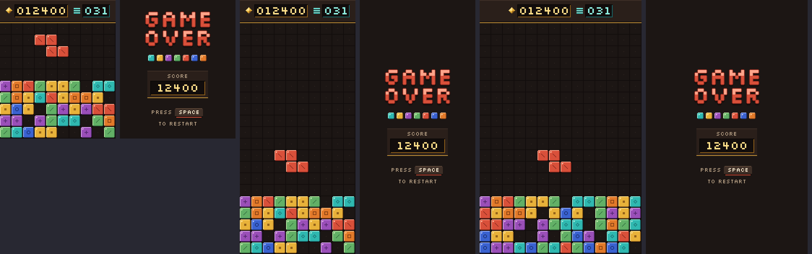

# pygame 미니게임 에셋

pygame으로 미니게임을 만들 때 쓰는 픽셀아트 에셋입니다.
모든 칸은 **16 × 16** 픽셀이고, 위쪽에 높이 **32**짜리 헤더가 붙습니다.

## 받는 방법

1. 이 페이지 위쪽의 **Code → Download ZIP** 을 눌러 받고 압축을 풉니다.
2. 만들 게임의 `<게임>_assets` 폴더를 내 `main.py` 와 **같은 위치**에 복사합니다.
3. 그 폴더 안의 `README.md` 에 파일 설명과 예제 코드가 있습니다.

| 게임 | 에셋 폴더 |
|---|---|
| 지뢰찾기 | [minesweeper_assets](minesweeper/dist/minesweeper_assets) |
| 스네이크 | [snake_assets](snake/dist/snake_assets) |
| 테트리스 | [tetris_assets](tetris/dist/tetris_assets) |

---

## 지뢰찾기

에셋 목록

실제 게임 화면 (맵 크기별, 승리·패배 화면)

## 스네이크

에셋 목록

실제 게임 화면 (맵 크기별, 게임 오버 화면)

## 테트리스

에셋 목록

실제 게임 화면 (보드 크기별, 게임 오버 화면)

---

폰트: [Silkscreen](https://fonts.google.com/specimen/Silkscreen) (SIL Open Font License, 각 `fonts/` 폴더에 라이선스 포함)
