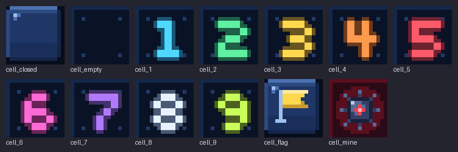
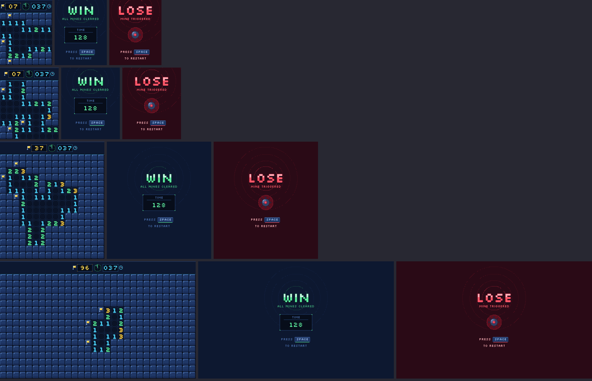

# Minesweeper Assets

[한국어](README.md) | **English**

Put the `minesweeper_assets` folder **in the same place** as your game code (`main.py`).

## Preview


In-game screens (by map size)



## Size rules
- One cell: **16 × 16**
- Header height: **32** (the board starts at y = 32)
- Screen size: width `cols × 16`, height `32 + rows × 16` (e.g. 9×9 → 144 × 176)
- Any map size works as long as it is at least **8 cells wide**.
- The screen is small, so use `pygame.SCALED`. The window is shown larger automatically, and coordinates stay in 16px units.
- Don't resize the images (no `transform.scale`). The pixels may get blurry.

## Files
| File | Size | When to use |
|---|---|---|
| `header.png` | 128×32 | Top of the screen during play (flags left, time) |
| `cells/cell_closed.png` | 16×16 | A cell that is not opened yet |
| `cells/cell_flag.png` | 16×16 | A cell with a flag |
| `cells/cell_empty.png` | 16×16 | An opened cell with 0 mines around it |
| `cells/cell_1.png` ~ `cell_9.png` | 16×16 | An opened cell with n mines around it |
| `cells/cell_mine.png` | 16×16 | An opened cell that was a mine |
| `cells/open_anim/open_0.png` ~ `open_5.png` | 32×32 (transparent background) | Burst animation when a cell opens (see below) |
| `cells/open_anim_fire/open_0.png` ~ `open_6.png` | 32×32 (transparent background) | Same, but with a fiery explosion |
| `screens/win.png` | 256×288 (transparent background) | When you win |
| `screens/lose.png` | 256×288 (transparent background) | When you lose |
| `fonts/Silkscreen-Regular.ttf` | | Font for drawing numbers (size **16**) |

## Example code

```python
import pygame

COLS, ROWS = 9, 9
W, H = COLS * 16, 32 + ROWS * 16

pygame.init()
screen = pygame.display.set_mode((W, H), pygame.SCALED)   # SCALED: shows the window larger

A = "minesweeper_assets/"
font = pygame.font.Font(A + "fonts/Silkscreen-Regular.ttf", 16)
header = pygame.image.load(A + "header.png").convert()
closed = pygame.image.load(A + "cells/cell_closed.png").convert()
win = pygame.image.load(A + "screens/win.png").convert_alpha()    # transparent background → convert_alpha
lose = pygame.image.load(A + "screens/lose.png").convert_alpha()


def draw_text(text, rect, color):
    """Draw text in the exact center of the rect."""
    surf = font.render(text, False, color)          # False = keep pixels sharp
    glyph = surf.get_bounding_rect()                # the part where the letters actually are
    box = pygame.Rect(rect)
    screen.blit(surf, (box.centerx - glyph.centerx, box.centery - glyph.centery))


def draw_header(flags_left, seconds):
    # 1) Stretch the leftmost 1px column of the header across the screen as a background
    strip = header.subsurface((0, 0, 1, 32))
    screen.blit(pygame.transform.scale(strip, (W, 32)), (0, 0))
    # 2) Place the header image in the center
    hx = (W - header.get_width()) // 2
    screen.blit(header, (hx, 0))
    # 3) Numbers: positions are relative to the header image, so add hx
    draw_text(f"{flags_left:02d}", (hx + 13, 7, 38, 18), (255, 216, 79))
    draw_text(f"{seconds:03d}", (hx + 76, 7, 38, 18), (79, 216, 255))


def draw_win(seconds):
    screen.fill((13, 24, 48))                                   # background color
    box = win.get_rect(center=screen.get_rect().center)          # center of the screen
    screen.blit(win, box)
    draw_text(str(seconds), (box.x + 92, box.y + 146, 72, 20), (94, 240, 160))


def draw_lose():
    screen.fill((42, 10, 22))                                   # background color
    screen.blit(lose, lose.get_rect(center=screen.get_rect().center))


# Example of the in-game screen
draw_header(10, 37)
for r in range(ROWS):
    for c in range(COLS):
        screen.blit(closed, (c * 16, 32 + r * 16))              # position of cell (c, r)
pygame.display.flip()
```

## Cell opening animation
When a cell opens, the closed cell cracks → flashes → breaks into pieces that fly outward. 6 frames.

- Frames are **32×32** with the cell (16×16) in the middle, so draw them **8 pixels up and left** of the cell position.
- Draw the cell as **opened** first (`cell_1` etc.), then draw the frame on top. Frame 0 covers it with the closed cell.
- Pieces fly into neighbor cells, so draw the animation **after all board cells**, and draw the header after that.
- About 40 ms per frame looks natural (0.24 s in total).
- For the **fire version**, change the folder to `open_anim_fire` and the count to `range(7)`. Size and drawing are exactly the same.

```python
open_anim = [pygame.image.load(A + f"cells/open_anim/open_{i}.png").convert_alpha()
             for i in range(6)]
FRAME_MS = 40
opening = {}                       # (c, r) -> time the cell was opened

# when you open cell (c, r)
opening[(c, r)] = pygame.time.get_ticks()

# when drawing: after drawing all board cells
now = pygame.time.get_ticks()
for (c, r), start in list(opening.items()):
    i = (now - start) // FRAME_MS          # which frame to show now
    if i >= len(open_anim):
        del opening[(c, r)]                # finished, remove it
        continue
    if i < 0:                              # not started yet (see tip)
        screen.blit(closed, (c * 16, 32 + r * 16))
        continue
    screen.blit(open_anim[i], (c * 16 - 8, 32 + r * 16 - 8))
```

Tip: when empty cells open in a chain, start the cells farther from the clicked one a bit later and it spreads like a wave.
Delay the start time, like `opening[(c, r)] = now + distance * 40`.

## Where to draw numbers
| Where | Rect (x, y, width, height) | Text color (R, G, B) |
|---|---|---|
| Header — flags left | relative to header image (13, 7, 38, 18) | (255, 216, 79) |
| Header — time | relative to header image (76, 7, 38, 18) | (79, 216, 255) |
| Win screen — time taken | relative to win.png (92, 146, 72, 20) | (94, 240, 160) |

## Font license
The Silkscreen font uses the SIL Open Font License (free, can be redistributed). Keep `fonts/Silkscreen-OFL.txt` together with the font.
