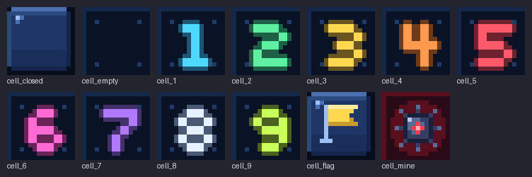
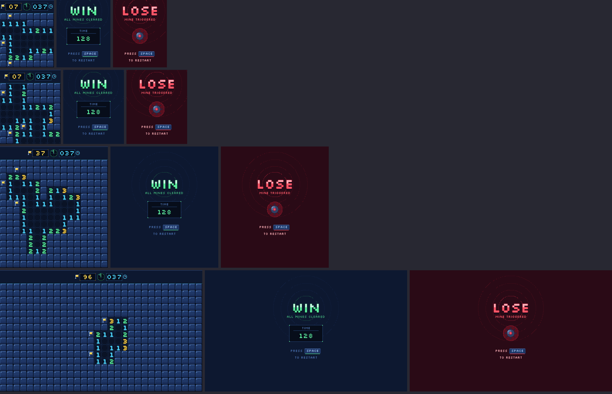

# 지뢰찾기 에셋

**한국어** | [English](README.en.md)

`minesweeper_assets` 폴더를 내 게임 코드(`main.py`)와 **같은 위치**에 넣고 사용하세요.

## 미리보기


실제 게임 화면 (맵 크기별)



## 크기 규칙
- 칸 하나: **16 × 16**
- 헤더 높이: **32** (보드는 y = 32부터 시작)
- 화면 크기: 가로 `열 × 16`, 세로 `32 + 행 × 16` (예: 9×9 → 144 × 176)
- 맵은 가로 **8칸 이상**이면 크기와 상관없이 사용할 수 있습니다.
- 화면이 작으니 `pygame.SCALED`를 쓰세요. 창이 자동으로 크게 보이고, 좌표는 그대로 16px 기준입니다.
- 이미지 크기는 바꾸지 마세요(`transform.scale` X). 픽셀이 깨질 수 있습니다.

## 파일
| 파일 | 크기 | 언제 쓰나 |
|---|---|---|
| `header.png` | 128×32 | 게임 중 맨 위 (깃발 개수, 시간 표시창) |
| `cells/cell_closed.png` | 16×16 | 아직 안 연 칸 |
| `cells/cell_flag.png` | 16×16 | 깃발을 꽂은 칸 |
| `cells/cell_empty.png` | 16×16 | 연 칸, 주변 지뢰 0개 |
| `cells/cell_1.png` ~ `cell_9.png` | 16×16 | 연 칸, 주변 지뢰 n개 |
| `cells/cell_mine.png` | 16×16 | 열었는데 지뢰인 칸 |
| `cells/open_anim/open_0.png` ~ `open_5.png` | 32×32 (투명 배경) | 칸이 열릴 때 터지는 애니메이션 (아래 설명) |
| `cells/open_anim_fire/open_0.png` ~ `open_6.png` | 32×32 (투명 배경) | 위와 같은데 불꽃이 터지는 버전 |
| `screens/win.png` | 256×288 (투명 배경) | 이겼을 때 |
| `screens/lose.png` | 256×288 (투명 배경) | 졌을 때 |
| `fonts/Silkscreen-Regular.ttf` | | 숫자를 그릴 때 쓰는 폰트 (크기 **16**) |

## 예제 코드

```python
import pygame

COLS, ROWS = 9, 9
W, H = COLS * 16, 32 + ROWS * 16

pygame.init()
screen = pygame.display.set_mode((W, H), pygame.SCALED)   # SCALED: 창을 크게 보여줌

A = "minesweeper_assets/"
font = pygame.font.Font(A + "fonts/Silkscreen-Regular.ttf", 16)
header = pygame.image.load(A + "header.png").convert()
closed = pygame.image.load(A + "cells/cell_closed.png").convert()
win = pygame.image.load(A + "screens/win.png").convert_alpha()    # 투명 배경 → convert_alpha
lose = pygame.image.load(A + "screens/lose.png").convert_alpha()


def draw_text(text, rect, color):
    """rect 사각형 한가운데에 글자를 그린다."""
    surf = font.render(text, False, color)          # False = 픽셀이 번지지 않음
    glyph = surf.get_bounding_rect()                # 실제 글자가 있는 부분
    box = pygame.Rect(rect)
    screen.blit(surf, (box.centerx - glyph.centerx, box.centery - glyph.centery))


def draw_header(flags_left, seconds):
    # 1) 헤더 이미지의 왼쪽 끝 1줄을 화면 너비만큼 늘려서 바탕으로 깐다
    strip = header.subsurface((0, 0, 1, 32))
    screen.blit(pygame.transform.scale(strip, (W, 32)), (0, 0))
    # 2) 헤더 이미지를 가운데에 놓는다
    hx = (W - header.get_width()) // 2
    screen.blit(header, (hx, 0))
    # 3) 숫자: 위치는 헤더 이미지 기준이라 hx 를 더한다
    draw_text(f"{flags_left:02d}", (hx + 13, 7, 38, 18), (255, 216, 79))
    draw_text(f"{seconds:03d}", (hx + 76, 7, 38, 18), (79, 216, 255))


def draw_win(seconds):
    screen.fill((13, 24, 48))                                   # 바탕색
    box = win.get_rect(center=screen.get_rect().center)          # 화면 가운데
    screen.blit(win, box)
    draw_text(str(seconds), (box.x + 92, box.y + 146, 72, 20), (94, 240, 160))


def draw_lose():
    screen.fill((42, 10, 22))                                   # 바탕색
    screen.blit(lose, lose.get_rect(center=screen.get_rect().center))


# 게임 중 화면 예시
draw_header(10, 37)
for r in range(ROWS):
    for c in range(COLS):
        screen.blit(closed, (c * 16, 32 + r * 16))              # 칸 (c, r) 위치
pygame.display.flip()
```

## 칸 여는 애니메이션
칸을 열면 닫힌 칸이 금이 가고 → 번쩍 → 조각나 사방으로 튀는 6장짜리 애니메이션입니다.

- 프레임은 **32×32** 이고, 칸(16×16)이 가운데에 있습니다. 그래서 칸 위치에서 **8씩 빼서** 그립니다.
- 칸은 먼저 **열린 그림**(`cell_1` 등)으로 그리고, 그 위에 프레임을 덮어 그립니다. 0번 프레임이 닫힌 칸을 그대로 덮어줍니다.
- 조각이 옆 칸까지 튀니까 **보드 칸을 전부 그린 다음에** 애니메이션을 그리고, 헤더는 그 뒤에 그리세요.
- 한 장에 40ms 정도면 자연스럽습니다 (전체 0.24초).
- **불꽃 버전**을 쓰려면 폴더를 `open_anim_fire` 로, 장수를 `range(7)` 로 바꾸면 됩니다. 크기와 그리는 방법은 똑같습니다.

```python
open_anim = [pygame.image.load(A + f"cells/open_anim/open_{i}.png").convert_alpha()
             for i in range(6)]
FRAME_MS = 40
opening = {}                       # (c, r) -> 그 칸을 연 시각

# 칸 (c, r) 을 열 때
opening[(c, r)] = pygame.time.get_ticks()

# 그릴 때: 보드 칸을 다 그린 다음에
now = pygame.time.get_ticks()
for (c, r), start in list(opening.items()):
    i = (now - start) // FRAME_MS          # 지금 몇 번째 프레임인지
    if i >= len(open_anim):
        del opening[(c, r)]                # 다 끝났으면 지운다
        continue
    if i < 0:                              # 아직 시작 전 (아래 팁)
        screen.blit(closed, (c * 16, 32 + r * 16))
        continue
    screen.blit(open_anim[i], (c * 16 - 8, 32 + r * 16 - 8))
```

팁: 빈 칸이 연달아 열릴 때 처음 누른 칸에서 멀수록 늦게 시작하면 파도처럼 퍼집니다.
`opening[(c, r)] = now + 거리 * 40` 처럼 시작 시각을 미뤄 주세요.

## 숫자 위치 정리
| 어디에 | 사각형 (x, y, 너비, 높이) | 글자 색 (R, G, B) |
|---|---|---|
| 헤더 — 남은 깃발 개수 | 헤더 이미지 기준 (13, 7, 38, 18) | (255, 216, 79) |
| 헤더 — 시간 | 헤더 이미지 기준 (76, 7, 38, 18) | (79, 216, 255) |
| 승리 화면 — 걸린 시간 | win.png 기준 (92, 146, 72, 20) | (94, 240, 160) |

## 폰트 라이선스
Silkscreen 폰트는 SIL Open Font License(무료, 재배포 가능)를 따릅니다. `fonts/Silkscreen-OFL.txt`를 폰트와 함께 두세요.
