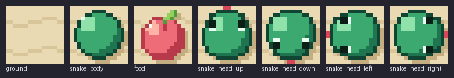
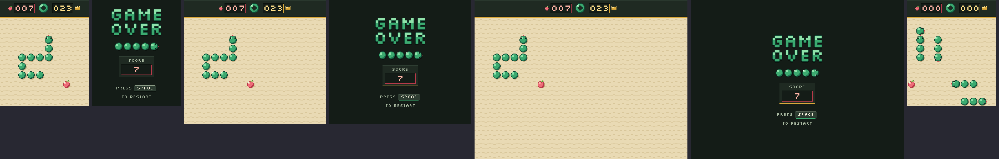

# Snake Assets

[한국어](README.md) | **English**

Put the `snake_assets` folder **in the same place** as your game code (`main.py`).

## Preview


In-game screens (by map size)



## Size rules
- One cell: **16 × 16**
- Header height: **32** (the map starts at y = 32)
- Screen size: width `cols × 16`, height `32 + rows × 16` (e.g. 16×12 → 256 × 224)
- Any map size works as long as it is at least **10 cells wide** and **10 cells tall**.
- The screen is small, so use `pygame.SCALED`. The window is shown larger automatically, and coordinates stay in 16px units.
- Don't resize the images (no `transform.scale`). Don't rotate the head either — pick the image for each direction.

## Files
| File | Size | When to use |
|---|---|---|
| `header.png` | 160×32 | Top of the screen during play (score, best score) |
| `cells/ground.png` | 16×16 | Ground (draw it on every cell first) |
| `cells/food.png` | 16×16 (transparent background) | Food (a peach) |
| `cells/snake_body.png` | 16×16 (transparent background) | Body. It is a round bead, so use it as-is on turning cells too |
| `cells/snake_head_up.png` / `_down` / `_left` / `_right` | 16×16 (transparent background) | Head. Pick the image that matches the moving direction |
| `screens/gameover.png` | 160×192 (transparent background) | Game over |
| `fonts/Silkscreen-Regular.ttf` | | Font for drawing numbers (size **16**) |

**Drawing order**: ground → food → body → head. Images with a transparent background must be drawn on top of the ground to be visible.

## Example code

```python
import pygame

COLS, ROWS = 16, 12
W, H = COLS * 16, 32 + ROWS * 16

pygame.init()
screen = pygame.display.set_mode((W, H), pygame.SCALED)   # SCALED: shows the window larger

A = "snake_assets/"
font = pygame.font.Font(A + "fonts/Silkscreen-Regular.ttf", 16)
header = pygame.image.load(A + "header.png").convert()
ground = pygame.image.load(A + "cells/ground.png").convert()
food = pygame.image.load(A + "cells/food.png").convert_alpha()          # transparent background → convert_alpha
body = pygame.image.load(A + "cells/snake_body.png").convert_alpha()
heads = {}                                                   # "up" → image, "down" → image ...
for d in ["up", "down", "left", "right"]:
    heads[d] = pygame.image.load(A + f"cells/snake_head_{d}.png").convert_alpha()
gameover = pygame.image.load(A + "screens/gameover.png").convert_alpha()


def draw_text(text, rect, color):
    """Draw text in the exact center of the rect."""
    surf = font.render(text, False, color)          # False = keep pixels sharp
    glyph = surf.get_bounding_rect()                # the part where the letters actually are
    box = pygame.Rect(rect)
    screen.blit(surf, (box.centerx - glyph.centerx, box.centery - glyph.centery))


def draw_header(score, best):
    # 1) Stretch the leftmost 1px column of the header across the screen as a background
    strip = header.subsurface((0, 0, 1, 32))
    screen.blit(pygame.transform.scale(strip, (W, 32)), (0, 0))
    # 2) Place the header image in the center
    hx = (W - header.get_width()) // 2
    screen.blit(header, (hx, 0))
    # 3) Numbers: positions are relative to the header image, so add hx
    draw_text(f"{score:03d}", (hx + 25, 6, 38, 18), (255, 180, 166))
    draw_text(f"{best:03d}", (hx + 94, 6, 38, 18), (255, 224, 138))


def draw_gameover(score):
    screen.fill((20, 28, 23))                                    # background color
    box = gameover.get_rect(center=screen.get_rect().center)    # center of the screen
    screen.blit(gameover, box)
    draw_text(str(score), (box.x + 52, box.y + 116, 56, 20), (255, 180, 166))


def cell(c, r):
    """Screen position of cell (c, r)"""
    return (c * 16, 32 + r * 16)


# Example of the in-game screen — snake[0] is the head
snake = [(5, 4), (4, 4), (3, 4), (3, 5)]
direction = "right"
apple = (9, 6)

draw_header(3, 12)
for r in range(ROWS):                                       # 1) ground
    for c in range(COLS):
        screen.blit(ground, cell(c, r))
screen.blit(food, cell(*apple))                             # 2) food
for part in snake[1:]:                                      # 3) body
    screen.blit(body, cell(*part))
screen.blit(heads[direction], cell(*snake[0]))              # 4) head (image for the direction)
pygame.display.flip()
```

## Where to draw numbers
| Where | Rect (x, y, width, height) | Text color (R, G, B) |
|---|---|---|
| Header — score (3 digits) | relative to header image (25, 6, 38, 18) | (255, 180, 166) |
| Header — best score (3 digits) | relative to header image (94, 6, 38, 18) | (255, 224, 138) |
| Game over — score | relative to gameover.png (52, 116, 56, 20) | (255, 180, 166) |

## Font license
The Silkscreen font uses the SIL Open Font License (free, can be redistributed). Keep `fonts/Silkscreen-OFL.txt` together with the font.
