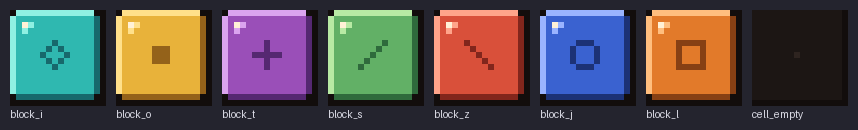
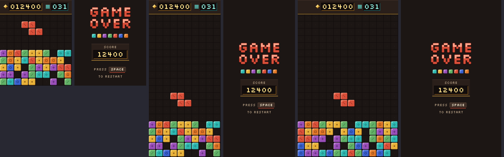

# Tetris Assets

[한국어](README.md) | **English**

Put the `tetris_assets` folder **in the same place** as your game code (`main.py`).

## Preview


In-game screens (by board size)



## Size rules
- One cell: **16 × 16**
- Header height: **32** (the board starts at y = 32)
- Screen size: width `cols × 16`, height `32 + rows × 16` (e.g. 10×20 → 160 × 352)
- Any board size works as long as it is at least **10 cells wide** and **10 cells tall**.
- The screen is small, so use `pygame.SCALED`. The window is shown larger automatically, and coordinates stay in 16px units.
- Don't resize the images (no `transform.scale`). The pixels may get blurry.

## Files
| File | Size | When to use |
|---|---|---|
| `header.png` | 160×32 | Top of the screen during play (score, lines cleared) |
| `cells/cell_empty.png` | 16×16 | An empty cell on the board |
| `cells/block_i.png` ~ `block_l.png` | 16×16 | 7 piece types: `i o t s z j l` (each has its own color and pattern) |
| `screens/gameover.png` | 160×192 (transparent background) | Game over |
| `fonts/Silkscreen-Regular.ttf` | | Font for drawing numbers (size **16**) |

## Example code

```python
import pygame

COLS, ROWS = 10, 20
W, H = COLS * 16, 32 + ROWS * 16

pygame.init()
screen = pygame.display.set_mode((W, H), pygame.SCALED)   # SCALED: shows the window larger

A = "tetris_assets/"
font = pygame.font.Font(A + "fonts/Silkscreen-Regular.ttf", 16)
header = pygame.image.load(A + "header.png").convert()
empty = pygame.image.load(A + "cells/cell_empty.png").convert()
blocks = {}                                                  # "i" → image, "o" → image ...
for k in "iotszjl":
    blocks[k] = pygame.image.load(A + f"cells/block_{k}.png").convert()
gameover = pygame.image.load(A + "screens/gameover.png").convert_alpha()   # transparent background → convert_alpha


def draw_text(text, rect, color):
    """Draw text in the exact center of the rect."""
    surf = font.render(text, False, color)          # False = keep pixels sharp
    glyph = surf.get_bounding_rect()                # the part where the letters actually are
    box = pygame.Rect(rect)
    screen.blit(surf, (box.centerx - glyph.centerx, box.centery - glyph.centery))


def draw_header(score, lines):
    # 1) Stretch the leftmost 1px column of the header across the screen as a background
    strip = header.subsurface((0, 0, 1, 32))
    screen.blit(pygame.transform.scale(strip, (W, 32)), (0, 0))
    # 2) Place the header image in the center
    hx = (W - header.get_width()) // 2
    screen.blit(header, (hx, 0))
    # 3) Numbers: positions are relative to the header image, so add hx
    draw_text(f"{score:06d}", (hx + 20, 6, 74, 18), (255, 224, 138))
    draw_text(f"{lines:03d}", (hx + 114, 6, 38, 18), (143, 240, 226))


def draw_gameover(score):
    screen.fill((28, 22, 20))                                    # background color
    box = gameover.get_rect(center=screen.get_rect().center)    # center of the screen
    screen.blit(gameover, box)
    draw_text(str(score), (box.x + 42, box.y + 112, 76, 20), (255, 224, 138))


# Example of the in-game screen — board[r][c] is None (empty) or a piece name ("i", "o", ...)
board = [[None] * COLS for _ in range(ROWS)]
board[ROWS - 1][0:4] = ["i", "i", "i", "i"]
board[ROWS - 2][4:6] = ["o", "o"]
board[ROWS - 1][4:6] = ["o", "o"]

draw_header(1200, 3)
for r in range(ROWS):
    for c in range(COLS):
        x, y = c * 16, 32 + r * 16                          # position of cell (c, r)
        if board[r][c] is None:
            screen.blit(empty, (x, y))
        else:
            screen.blit(blocks[board[r][c]], (x, y))
pygame.display.flip()
```

## Where to draw numbers
| Where | Rect (x, y, width, height) | Text color (R, G, B) |
|---|---|---|
| Header — score (6 digits) | relative to header image (20, 6, 74, 18) | (255, 224, 138) |
| Header — lines cleared (3 digits) | relative to header image (114, 6, 38, 18) | (143, 240, 226) |
| Game over — score | relative to gameover.png (42, 112, 76, 20) | (255, 224, 138) |

## Font license
The Silkscreen font uses the SIL Open Font License (free, can be redistributed). Keep `fonts/Silkscreen-OFL.txt` together with the font.
