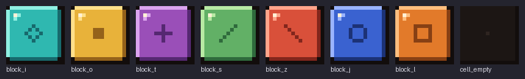
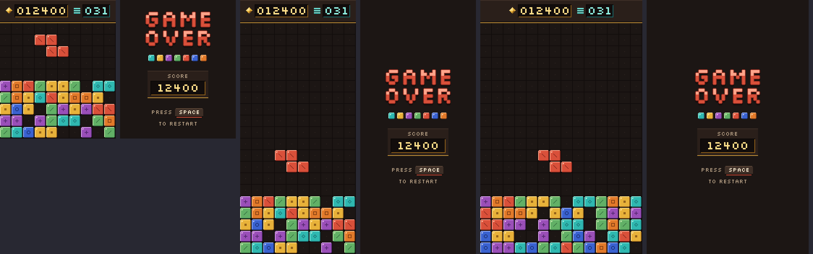

# 테트리스 에셋

**한국어** | [English](README.en.md)

`tetris_assets` 폴더를 내 게임 코드(`main.py`)와 **같은 위치**에 넣고 사용하세요.

## 미리보기


실제 게임 화면 (맵 크기별)



## 크기 규칙
- 칸 하나: **16 × 16**
- 헤더 높이: **32** (보드는 y = 32부터 시작)
- 화면 크기: 가로 `열 × 16`, 세로 `32 + 행 × 16` (예: 10×20 → 160 × 352)
- 보드는 가로 **10칸 이상**, 세로 **10칸 이상**이면 크기와 상관없이 사용할 수 있습니다.
- 화면이 작으니 `pygame.SCALED`를 쓰세요. 창이 자동으로 크게 보이고, 좌표는 그대로 16px 기준입니다.
- 이미지 크기는 바꾸지 마세요(`transform.scale` X). 픽셀이 깨질 수 있습니다.

## 파일
| 파일 | 크기 | 언제 쓰나 |
|---|---|---|
| `header.png` | 160×32 | 게임 중 맨 위 (점수, 지운 줄 수 표시창) |
| `cells/cell_empty.png` | 16×16 | 보드의 빈 칸 |
| `cells/block_i.png` ~ `block_l.png` | 16×16 | 조각 7종류: `i o t s z j l` (조각마다 색과 무늬가 다름) |
| `screens/gameover.png` | 160×192 (투명 배경) | 게임 오버 |
| `fonts/Silkscreen-Regular.ttf` | | 숫자를 그릴 때 쓰는 폰트 (크기 **16**) |

## 예제 코드

```python
import pygame

COLS, ROWS = 10, 20
W, H = COLS * 16, 32 + ROWS * 16

pygame.init()
screen = pygame.display.set_mode((W, H), pygame.SCALED)   # SCALED: 창을 크게 보여줌

A = "tetris_assets/"
font = pygame.font.Font(A + "fonts/Silkscreen-Regular.ttf", 16)
header = pygame.image.load(A + "header.png").convert()
empty = pygame.image.load(A + "cells/cell_empty.png").convert()
blocks = {}                                                  # "i" → 이미지, "o" → 이미지 ...
for k in "iotszjl":
    blocks[k] = pygame.image.load(A + f"cells/block_{k}.png").convert()
gameover = pygame.image.load(A + "screens/gameover.png").convert_alpha()   # 투명 배경 → convert_alpha


def draw_text(text, rect, color):
    """rect 사각형 한가운데에 글자를 그린다."""
    surf = font.render(text, False, color)          # False = 픽셀이 번지지 않음
    glyph = surf.get_bounding_rect()                # 실제 글자가 있는 부분
    box = pygame.Rect(rect)
    screen.blit(surf, (box.centerx - glyph.centerx, box.centery - glyph.centery))


def draw_header(score, lines):
    # 1) 헤더 이미지의 왼쪽 끝 1줄을 화면 너비만큼 늘려서 바탕으로 깐다
    strip = header.subsurface((0, 0, 1, 32))
    screen.blit(pygame.transform.scale(strip, (W, 32)), (0, 0))
    # 2) 헤더 이미지를 가운데에 놓는다
    hx = (W - header.get_width()) // 2
    screen.blit(header, (hx, 0))
    # 3) 숫자: 위치는 헤더 이미지 기준이라 hx 를 더한다
    draw_text(f"{score:06d}", (hx + 20, 6, 74, 18), (255, 224, 138))
    draw_text(f"{lines:03d}", (hx + 114, 6, 38, 18), (143, 240, 226))


def draw_gameover(score):
    screen.fill((28, 22, 20))                                    # 바탕색
    box = gameover.get_rect(center=screen.get_rect().center)    # 화면 가운데
    screen.blit(gameover, box)
    draw_text(str(score), (box.x + 42, box.y + 112, 76, 20), (255, 224, 138))


# 게임 중 화면 예시 — board[r][c] 는 None(빈 칸) 또는 조각 이름("i", "o", ...)
board = [[None] * COLS for _ in range(ROWS)]
board[ROWS - 1][0:4] = ["i", "i", "i", "i"]
board[ROWS - 2][4:6] = ["o", "o"]
board[ROWS - 1][4:6] = ["o", "o"]

draw_header(1200, 3)
for r in range(ROWS):
    for c in range(COLS):
        x, y = c * 16, 32 + r * 16                          # 칸 (c, r) 위치
        if board[r][c] is None:
            screen.blit(empty, (x, y))
        else:
            screen.blit(blocks[board[r][c]], (x, y))
pygame.display.flip()
```

## 숫자 위치 정리
| 어디에 | 사각형 (x, y, 너비, 높이) | 글자 색 (R, G, B) |
|---|---|---|
| 헤더 — 점수 (6자리) | 헤더 이미지 기준 (20, 6, 74, 18) | (255, 224, 138) |
| 헤더 — 지운 줄 수 (3자리) | 헤더 이미지 기준 (114, 6, 38, 18) | (143, 240, 226) |
| 게임 오버 — 점수 | gameover.png 기준 (42, 112, 76, 20) | (255, 224, 138) |

## 폰트 라이선스
Silkscreen 폰트는 SIL Open Font License(무료, 재배포 가능)를 따릅니다. `fonts/Silkscreen-OFL.txt`를 폰트와 함께 두세요.
